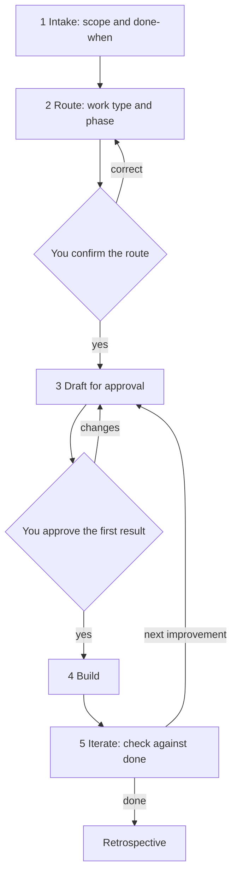

# Process diagram

This diagram shows the five stages every piece of work follows, from first request to finished result. Stages 3 to 5 repeat on top of the previous version until the work meets its definition of done.

## Reading the diagram

- **Intake.** The system asks for the goal, scope, definition of done, audience, constraints and how much involvement you want. It writes the scope.
- **Route.** The system chooses the work type and phase and states why. You confirm or correct.
- **Draft for approval.** The system writes the first result in the smallest form that can be judged and lists open questions.
- **First result decision.** You review, answer and approve before any build.
- **Build.** The system implements against the approved first result and reports at agreed points.
- **Iterate.** The system checks the result against the definition of done and proposes the next improvement. When the work ends it writes a retrospective.

You decide at two points only: the route and the first result, plus your answers during intake. The system does everything else.

Read the stages in words on [How work is organised](../start-here/how-work-is-organised.md).
